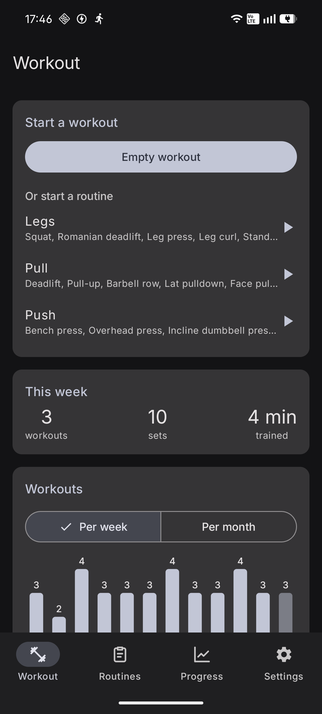
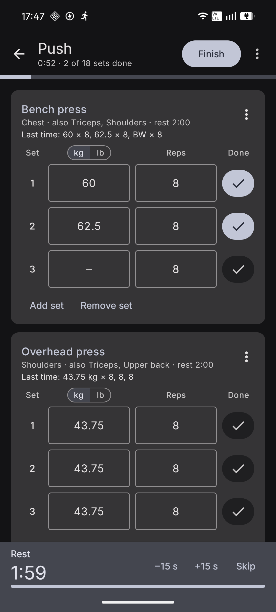
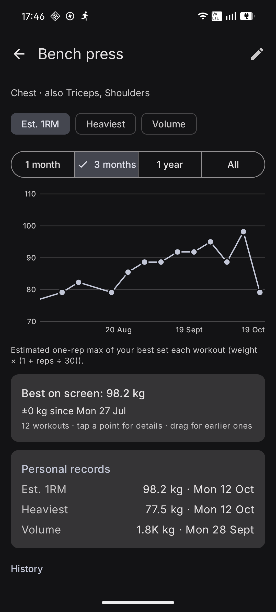
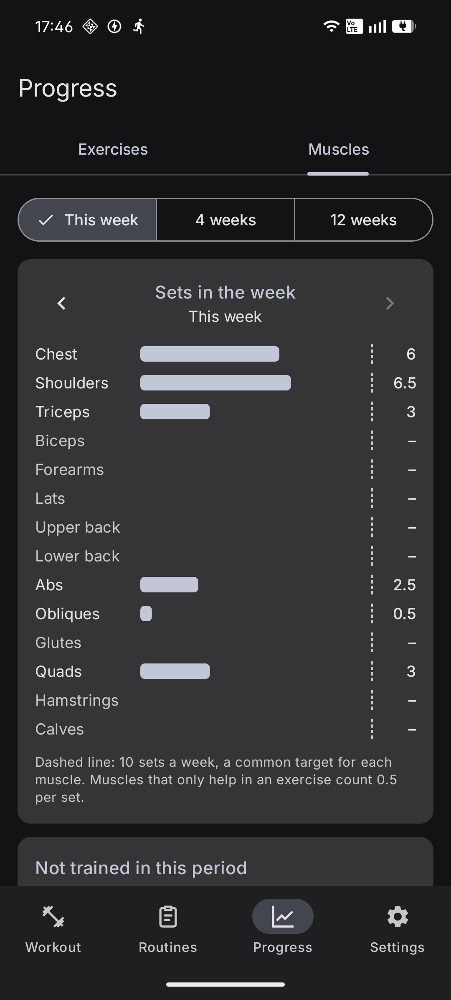

# GymTracker

A workout tracker for Android that keeps your data on your phone. No account, no ads, no tracking.

<p>
  
  
  
  
</p>

## Features

- **Track workouts.** Start from a routine or an empty workout and add exercises as you go. Edit weights, reps and times freely, and tick each set when it's done.
- **Reps or time, with or without weight.** Push-ups track reps only, planks a time, a farmer's carry a time and a weight.
- **Timers.** Ticking a set starts the rest timer; timed sets have their own countdown, shown in a panel at the bottom with the set on the timer highlighted. Pause and resume from the exact second, even if the app is closed in between, and start another timed set to pause the running one. The last three seconds tick and a boxing bell rings at the end (over your music, which is lowered for a moment), and the phone buzzes.
- **Auto-run.** Press **Go** and the app runs a workout's timed sets on its own: each set, its rest, then the next one, scrolling to the set that starts. It pauses before an exercise done by reps (tick its sets and resume), and can be switched off at any time.
- **Timer notification.** While a timer runs, a notification shows the countdown with a progress bar and buttons to pause, skip or stop auto-run, so you can follow it without opening the app. Timers keep running with the screen off.
- **Last time, at a glance.** Each exercise shows what you did last time, and weights are pre-filled from it.
- **kg or lb.** Switch an exercise to pounds, type the weight, and switch back: it's converted.
- **Routines and exercises.** Comes with about 60 common exercises; add your own with the muscles they mainly work and the ones that help.
- **Progress.** A chart per exercise (estimated one-rep max, heaviest weight, volume, reps or time), personal records, workouts per week or month, and sets per muscle each week. Drag the charts to look further back.
- **Widgets.** Quick start (an empty workout, your most used routines, or resume the one in progress), this week's workouts, sets and time, and sets per muscle this week.
- **Your data stays yours.** JSON backup/restore to move phones, and export to Excel (`.xlsx`) for your own analysis.

## Install

Download the APK from the [latest release](https://github.com/azr4e1/gymtracker/releases/latest) and open it on your phone (you'll be asked to allow installing apps from your browser or file manager).

To get updates automatically, add this repository to [Obtainium](https://github.com/ImranR98/Obtainium).

Requires Android 12 or newer.

## Build from source

Requirements: JDK 21 and the Android SDK (Android Studio installs it).

```bash
git clone https://github.com/azr4e1/gymtracker.git
cd gymtracker
./gradlew installDebug        # build and install a debug build on a connected phone
./gradlew assembleRelease     # optimized build in app/build/outputs/apk/release/
```

Debug builds install next to the release app as "GymTracker (dev)", and have a Settings option to add three months of sample workouts. `./gradlew installStaging` installs "GymTracker (staging)": shrunk and optimized like a release build but debug-signed, for chasing bugs that only happen in release builds.

Optional `keystore.properties` (git-ignored) with `storeFile`, `storePassword`, `keyAlias`, `keyPassword` signs release builds. Without it, release builds are unsigned.

Built with Kotlin, Jetpack Compose, Room, Glance and fastexcel.

## Privacy

Everything you log is stored only on your device. The app doesn't connect to the internet (it has no internet permission). It asks once for permission to show notifications, used only for the timer.

## License

Copyright © 2026 Lorenzo Drumond

This program is free software: you can redistribute it and/or modify it under the terms of the GNU General Public License as published by the Free Software Foundation, either version 3 of the License, or (at your option) any later version. See [LICENSE](LICENSE).
